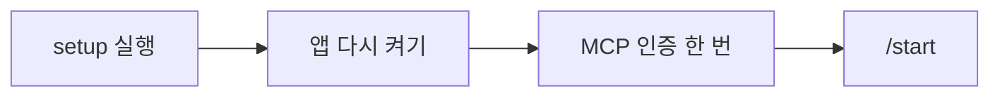
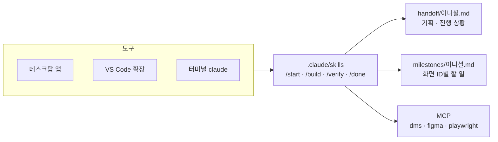
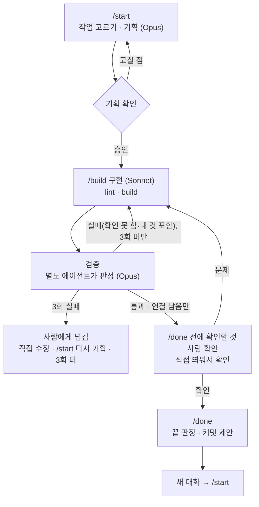

# 냥멍케어 프론트엔드

반려동물 케어 웹서비스 냥멍케어의 프론트엔드. React 19 + Vite, JavaScript.

- 규칙: `AGENTS.md`, 나머지는 `docs/convention/`
- 아직 정하지 않은 것: `docs/OPEN_ISSUES.md`

## 처음 받았을 때



### setup

| OS | 실행 |
| --- | --- |
| Windows | `setup.bat` (cmd·PowerShell·탐색기 더블클릭) |
| 맥 | `bash setup.sh` |

- 여러 번 실행해도 된다.
- Windows에서 `bash setup.sh`를 치면 WSL이 떠서 안 된다.
- Codex를 쓰려면 Codex를 먼저 설치하고 setup을 실행한다.
- 끝나면 앱(VS Code·데스크탑 앱)을 다시 켠다. 새 PATH는 다시 켜야 잡힌다.

| setup이 하는 일 | 내용 |
| --- | --- |
| Git | 사용자 설정, 이니셜 브랜치, 훅(커밋의 `Co-Authored-By` 삭제, `yarn.lock`이 바뀌면 pull·브랜치 전환 뒤 `yarn install`) |
| AI 도구 | Claude Code·Codex 감지. 둘 다 없으면 Claude Code 설치 |
| VS Code 확장 | Prettier, ESLint, Claude Code |
| Node 24 · Yarn 1.22 | 없으면 설치, `yarn install` |
| `.env.local` | 없으면 `.env.example` 복사 |
| MCP | 아래 표 |
| 확인 | lint, build, dev 서버 |

### MCP

| MCP | 용도 |
| --- | --- |
| `dms` | 요구사항정의서·화면설계서·기능명세서 |
| `figma` | 디자인 |
| `playwright` | 화면 확인용 브라우저(창 없이 실행) |

- claude.ai 커넥터로 이미 연결돼 있으면 Claude Code에는 등록하지 않는다.
- 그 경우 `.env.local`의 `DMS_MCP_URL`은 비워도 된다. 아니면 디스코드에서 받는다.
- 인증: `/mcp` → 서버 선택 → Authenticate
- 데스크탑 앱은 Connectors 화면에서 인증한다(확인 필요).
- Codex는 등록할 때 로그인 창이 뜬다. 놓쳤으면 `codex mcp login <이름>`.
- `figma` MCP는 Starter 플랜 한도가 적어 스킬이 쓰지 않는다. 디자인은 아래 스크립트로 받는다.

### Figma 디자인

`/start`는 화면 ID로 이름을 지은 프레임(`SCR-MAN-001 메인`)을 찾아 기획에 적고, 구현할 때 그 PNG와 레이어 값을 본다.

1. Figma → 왼쪽 위 계정 → Settings → Security → Personal access tokens → Generate new token. 권한은 `File content` 읽기만.
2. `.env.local`의 `FIGMA_TOKEN=` 뒤에 붙인다. 디스코드에도 올리지 않는다.
3. 처음 한 번 `node scripts/figma.mjs pull`. 화면 프레임 전부를 `.cache/figma/`에 받는다.

| 명령 | 내용 |
| --- | --- |
| `node scripts/figma.mjs pull` | 받아 둔 게 없을 때만 받는다. API 3회 |
| `node scripts/figma.mjs pull --refresh` | 디자인이 바뀌었을 때 다시 받는다 |
| `node scripts/figma.mjs list` | 받은 화면 프레임 목록 |
| `node scripts/figma.mjs show SCR-MAN-001` | 레이어의 크기·간격·색·글자 |

- REST API 한도는 토큰 주인의 시트에 따른다. View·Collab 시트는 월 20회라 `--refresh`를 아낀다.
- 화면 프레임은 페이지나 섹션 바로 아래에 두고 이름을 화면 ID로 시작한다. 상태가 여럿이면 같은 화면 ID로 프레임을 여러 개 둔다(`SCR-MAN-001 메인 로그인 전`).

### 직접 실행

```
yarn dev
```

`/api` 요청은 `http://localhost:8080`(백엔드)으로 넘어간다.

## AI로 작업하기



| 도구 | 시작 |
| --- | --- |
| 데스크탑 앱 | [다운로드](https://claude.com/download) → Code 탭 → New session → Local, 이 폴더 |
| VS Code 확장 | 이 폴더 열기 → 왼쪽 막대의 Claude 아이콘 |
| 터미널 | 이 폴더에서 `claude` |

셋 다 같은 스킬과 MCP를 쓴다.

### 작업 흐름



| 할 일 | 입력 |
| --- | --- |
| 다음 작업 시작 | `/start` |
| 특정 화면 시작 | `/start COM-003` |
| 기획 승인 (구현·검증 루프 시작) | `승인` 또는 `/build` |
| 다시 검증 (직접 고친 뒤) | `/verify` |
| 마무리 | `/done` → `확인` → `커밋` → `푸시` → (마일스톤이 끝나면) `PR`. 병합은 GitHub에서 사람이 |
| 새 대화 | 터미널·VS Code `/clear`, 데스크탑 앱 Ctrl+N |

- 마일스톤 파일이 없으면 첫 `/start`가 먼저 만든다. 시간이 더 걸린다.
- 모델은 바꾸지 않는다. 기본은 Sonnet, `/start`와 검증(`/verify`, `/build` 안의 검증)만 Opus로 돈다.
- 마일스톤 `끝`은 `/done`만 정한다. 남의 API·화면을 기다려 연결만 남은 기능(연결 남음)은 `끝`을 막지 않고 마일스톤과 핸드오프 "다음에 할 것"에 남는다(`docs/convention/milestone.md`).
- 스킬이 `/` 목록에 없으면 새 대화를 연다.
- Codex(`$start`·`$build`·`$done`)도 같은 흐름이지만 두 가지가 다르다. 검증도 구현과 같은 모델(GPT)로 돈다(Opus 지정은 Claude Code 전용). 기준 파일 잠금 훅(`.codex/hooks.json`)은 처음 한 번 사람이 신뢰해야 돈다: 이 폴더를 처음 열 때 "신뢰" → `/hooks`에서 훅 승인. 훅 내용이 바뀌면 다시 승인한다.
- VS Code의 `/clear`는 확인 필요. 안 되면 명령 팔레트의 Open in New Tab.

### 사람 확인

`/build`가 끝에 주는 "`/done` 전에 확인할 것"(직접 `/verify`를 돌렸으면 그 보고)의 "사람 확인" 목록대로 확인한다.

1. 백엔드가 필요하면 백엔드 저장소에서 `./gradlew bootRun`
2. `/verify`가 띄워 둔 dev 서버가 있으면 그대로 쓴다. 없으면 이 저장소에서 `yarn dev` → `http://localhost:5173`
3. 목록의 주소에서 동작해 보고 기대 결과와 비교한다.
4. 아직 없는 남의 API는 가짜 응답으로 보인다.
5. 목록의 "바뀐 파일"을 훑어본다. 기획에 없는 파일이면 문제로 답한다.
6. Ctrl+C로 끈다.

## PR 전 확인

```
yarn lint
yarn build
```
